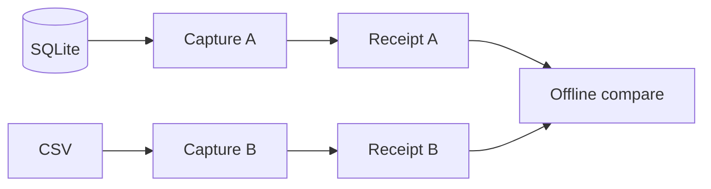

# RowReceipt

**Compare the rows in two copies of a dataset without moving either copy.**

Run RowReceipt next to your SQLite database and again next to a CSV export. Both sides produce a small authenticated receipt. Compare the receipts offline to catch missing rows, extra rows, or a changed value with the same row count. Use a shared typed contract to match columns even when their names and row order differ.

SQLite's `sqldiff` is useful when both databases are available and you want exact changes. `dbhash` can independently fingerprint SQLite databases. RowReceipt is for separated capture and comparison, including SQLite-to-CSV handoffs under an explicit contract. A comparison reveals which buckets changed while keeping the rows on the source machines. [sqldiff](https://www.sqlite.org/sqldiff.html) · [dbhash](https://www.sqlite.org/dbhash.html)

## Try it in under a minute

From this source checkout, with Python 3.11+ and SQLite 3.37+ installed:

```sh
python examples/demo.py
```

The demo captures a real SQLite database, a matching CSV export, and a CSV with one changed stock value. It removes both source files before comparing the receipts. The first comparison matches. The second reports two rows on each side, one changed bucket, and exit code 1.

Run the portable release archive with Python, or install the wheel for the `rowreceipt` command and Python API.

```sh
python dist/rowreceipt-0.1.0.pyz --help
python -m pip install --no-index --no-deps dist/rowreceipt-0.1.0-py3-none-any.whl
```

[Build or verify the release files](docs/build.md)

## Check an export

Adapt the [inventory contract](examples/inventory.contract.json) and the [column mapping](examples/inventory.csv-map.json). Create one key and share it with the two capture operators and the comparator via a separate secure channel. Agree on the snapshot cutoff before capturing.

```sh
rowreceipt keygen --out exchange.key

rowreceipt capture --sqlite before.db --table inventory --contract inventory.contract.json --key exchange.key --out before.receipt.json
rowreceipt capture --csv exported.csv --map inventory.csv-map.json --contract inventory.contract.json --key exchange.key --out after.receipt.json

rowreceipt compare before.receipt.json after.receipt.json --key exchange.key --json
```

Exit code **0** means match, **1** means mismatch, and **2** indicates an unusable input or operational failure. The comparison machine needs only the two receipts and key. Duplicate keys and values that violate the contract fail capture.



## Measured performance

In a five-run Linux benchmark, a 1,000,000-row SQLite capture took 8.35 s median and produced a 5,065-byte receipt. Comparing two receipts took 46 ms. Native SQLite tools were faster for their supported workflows. On the same data, `dbhash` took 162 ms for one SQLite source and `sqldiff` took 1.02 s with both SQLite databases available. [Methodology and raw results](docs/benchmarks.md)

## Scope and privacy

Version 0.1 reads one ordinary SQLite table or one UTF-8 CSV per capture. It checks the selected fields at the captured snapshot. Operators manage version alignment and handle diagnosis of changed buckets. Each authorized key holder can create a valid receipt. Receipts expose dataset counts, equality and bucket changes, so handle them as sensitive metadata. They contain no raw row values or primary key values.

Read the [architecture](docs/architecture.md), [protocol](docs/protocol.md), [Python API](docs/api.md) or [benchmark results](docs/benchmarks.md). Contributions are welcome, especially real migration cases represented with a small synthetic fixture. [Contributing](CONTRIBUTING.md) · [Security](SECURITY.md) · [Apache-2.0](LICENSE)
