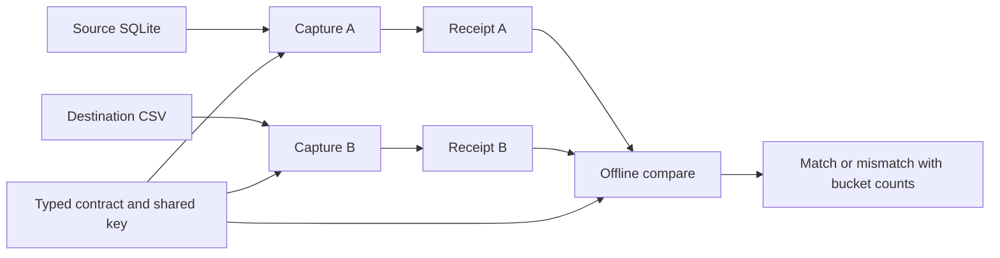

# Architecture

RowReceipt is a local process with a CLI and an importable Python core. Each capture operator reads only their own source and receives a receipt. A comparison process reads two receipt files and a shared key. The operators supply the file exchange and share the key through a separate approved channel.

## Technology decisions

| Technology | Decision and requirement |
|---|---|
| Python and SQLite | CPython 3.11+ offers streaming CSV, HMAC, native SQLite and a portable application archive through the standard library. SQLite accepts live WAL snapshots and provides a spillable B-tree. No third-party runtime packages. |
| Rust | A compiled CLI could reduce CPU and interpreter distribution costs. Reconsider if profiling shows row encoding or HMAC dispatch prevents the documented throughput goal. |
| Go | A single binary would simplify distribution. Maintainers would have to embed a SQLite implementation or use cgo and maintain native per-platform builds. |
| C and C++ | SQLite already supplies the native engine. New application code in these languages would increase native memory-safety and release maintenance work. |
| Kotlin Multiplatform, TypeScript, Tauri | These are plausible for mobile, SDK or UI use. The first workflow needs a terminal, streaming files and an embeddable local API across operating systems. |
| WebAssembly and WASI | A receipt-only verifier could fit WASM. Native source SQLite locking and local file integration are part of capture. |
| gRPC, QUIC, WebRTC, libp2p | The exchange boundary is a JSON file. A network listener, identity service, or transport implementation adds a job the operators already handle. |
| CRDTs | Each source contains one view of a dataset. The comparison compares equality and leaves synchronization to source systems. |
| Platform-native APIs | Restrict file access with the host OS. Use read-only SQLite URI modes and private temporary directories. Atomic publication uses a same-directory hard link. |

## Components and guarantees

The contract parser defines order and equality for each logical field. The SQLite and CSV adapters resolve physical column names and yield typed tuples. The SQLite adapter uses one read transaction for metadata and rows and reads WAL normally. It accepts ordinary tables and explicitly mapped ordinary columns. CSV is read sequentially and checked for size and timestamp changes while open. The operator should supply an immutable export.

The engine length-frames values, hashes keys and row payloads, and writes only keyed digests into a private B-tree ordered by bucket and hashed key. A duplicate logical key is a hard error. The scan reduces the sorted B-tree into fixed-size bucket counts and commitments, then authenticates the receipt envelope. There is one reader and writer per capture. Independent captures can run concurrently in separate scratch directories. The source snapshot may pin WAL pages until the scan finishes. The comparison needs memory proportional to the bucket count and does not require scratch.

Scratch is ephemeral, non-durable and removed on handled failures. A forced process kill can leave a private scratch directory or a temporary publication file. Start the capture again, using the same source snapshot when continuity matters. The CLI publishes output only after it has a complete receipt, and refuses to overwrite an existing filename. Ordinary local files and filesystems supporting hard links are the target. The tool does not promise that a newly published directory entry survives immediate power loss. The key seed is a 32-byte file created with restrictive POSIX permissions. Windows deployments rely on directory ACLs.

The CLI emits a human summary or machine-readable status. It emits no telemetry and reports source validation failures without values. The public API is the typed iterator boundary, two file adapters, validated contracts and receipts, and comparison. Additional adapters can call the same core iterator API with known types. The contract/receipt format strings protect against silent mixing of versions. New encoding rules require a new format, with old files remaining comparable by readers supporting their version.

## Threat model

Trusted operators control the contract, input paths and source selection and agree on the data cutoff separately. The receipt MAC detects edits by someone without the shared key. This symmetric MAC provides no independent identity or freshness and any key holder can fabricate a receipt. Receipts reveal logical contract identity, a key identifier, cardinality, equality, and per-bucket counts. A key holder can test guesses offline or deliberately issue captures against chosen data. Keep receipt access scoped accordingly and use a fresh random key and dataset identifier for independent exchanges. The protocol has no encryption, public signatures or differential privacy.

SQLite and CSV parsing still exercise native runtime code. Use a patched CPython and SQLite and an OS sandbox when inspecting hostile files. No caller-supplied SQL, views, extensions or virtual-table scans are needed. Resource budgets cover bounded input records and documents, and capture requires O(rows) temporary disk. Set OS time/storage quotas for hostile input. A compromised process can read plaintext and key material. Python does not guarantee erasure of values from process memory. Release scanning covers the installation environment separately from application dependencies.

## Initial budgets and verification

Target a default receipt below 8 KiB, less than 150 ms median CLI startup, under 128 MiB process RSS, at least 30,000 narrow SQLite rows per second and under 120 bytes of scratch per row on a current desktop-class SSD. These are targets for the maintained workload, subject to filesystem and machine variation. Measure process time and RSS, transient disk, receipt size, and changed-bucket behavior. Apply CI checks on Linux, macOS and Windows. Test framing, storage types, input errors, WAL read behavior, deterministic receipts, version rejection, file publication and the installed CLI. See the protocol and benchmark reports for semantics and measured results.
